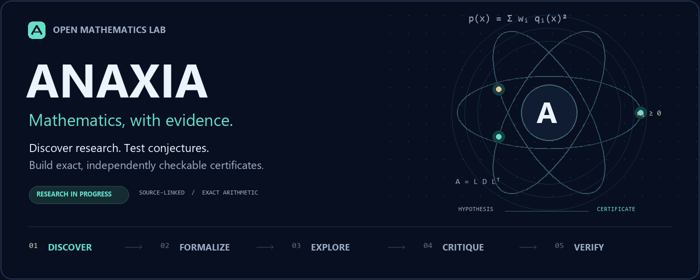

<picture>
  <source media="(prefers-reduced-motion: reduce)" srcset="docs/assets/anaxia-hero.png">
  
</picture>

<p align="center">
  <b>English</b> · <a href="docs/i18n/README.hi.md">हिन्दी</a> · <a href="docs/i18n/README.bn.md">বাংলা</a> · <a href="docs/i18n/README.es.md">Español</a> · <a href="docs/i18n/README.fr.md">Français</a> · <a href="docs/i18n/README.zh-CN.md">简体中文</a>
</p>

# Anaxia

Anaxia studies mathematical conjectures using exact arithmetic, reproducible experiments, and optional model proposals. Each result records the statement, its domain, and the evidence a reader can check. The exact tools run on Python's standard library with no model or API key.

[Get started](#get-started) · [Research targets](#research-targets) · [Research radar](#research-radar) · [Model setup](docs/MODELS.md) · [Paper audits](docs/PAPER-AUDIT.md)

[](https://github.com/creelie/Anaxia/actions/workflows/checks.yml) [](https://github.com/creelie/Anaxia/actions/workflows/research-radar.yml)

## Get started

With Python 3.10 or later, reproduce the proof that $x^4-2x^3+2x^2-2x+1\geq 0$ for every real $x$. The solver checks signs with exact Sturm root counts and saves a report for independent verification. [Saved quartic result](data/experiments/univariate-sturm.json)

```sh
git clone https://github.com/creelie/Anaxia.git
cd Anaxia
python anaxia.py solve examples/univariate-sturm.json --output proof.json
python anaxia.py verify proof.json
```

| Method | What the verifier establishes | Example |
| --- | --- | --- |
| Rational sum of squares | An exact identity proves nonnegativity over the reals. | [Quadratic](data/experiments/quadratic-sos.json) · [Quartic](data/experiments/quartic-sos.json) |
| Sturm root counting | An exact decision for supported single-variable polynomial inequalities over the reals. | [Quartic proof](data/experiments/univariate-sturm.json) |
| Modular obstruction | Exhausting residue classes can rule out every integer solution. | [Diophantine input](examples/modular-obstruction.json) |
| Exhaustive search | Exact witnesses refute the submitted claim, or exhaustive checks certify the specified finite domain. | [Bounded result](data/experiments/bounded-polynomial.json) · [Counterexample](data/experiments/false-polynomial.json) |

<details>
<summary>Run the other checks</summary>

```sh
python anaxia.py experiment --tasks config/research-tasks.json --output data/experiments
python anaxia.py challenge run --profile quick --output data/challenges
python anaxia.py diophantine examples/modular-obstruction.json --output modular-proof.json
python anaxia.py diophantine modular-proof.json --verify
```

The saved test results and the supported task format are documented in the [experiment digest](data/experiments/README.md) and [architecture guide](docs/ANAXIA.md).

</details>

## Research targets

| Target | Recorded evidence |
| --- | --- |
| Four-dimensional sphere packing | A sharp density bound covers the intermediate $D_4$ grid spacings, including nonperiodic selections of sites. The local arguments also classify which sets of 21 exact contacts guarantee containment of the 24-cell and handle a radial shell with one inner neighbor along a Voronoi vertex ray. [Grid bounds](docs/D4-GRID-PACKINGS.md) · [Contact classification](docs/D4-PARTIAL-CONTACTS.md) · [Radial shell](docs/D4-RADIAL-SHELL.md) |
| Riemann hypothesis | A reciprocal approximation of error $\varepsilon$ requires coefficient mass and support size of order at least $\varepsilon^{-2}$. Convergence remains open. [Coefficient bound](docs/RH-RECIPROCAL-COEFFICIENTS.md) |
| Yang–Mills existence and mass gap | A conditional criterion works with a smaller torus window and a larger allowed pressure. A separate calculation gives gapped and gapless spectra with identical finite correlator samples. [One-scale criterion](docs/YANG-MILLS-ONE-SCALE.md) · [Correlation samples](docs/YANG-MILLS-THERMAL-GAP.md) |
| Hodge conjecture | A dense elliptic isogeny orbit has unbounded graph degrees. A finite list of Hilbert polynomials for cycle representatives on dense fibers would suffice for a spreading argument. [Degree obstruction](docs/HODGE-DEGREE-OBSTRUCTION.md) |
| Reflexive-polytope descent in dimension four | The coverage calculation counts cases where the pair-bound method needs stronger certificates to reach 24. [Coverage report](data/d4-coverage.json) |
| $D_4$ kissing configuration | Exact checks verify the 24 roots and all 276 pair distances. This gives a lower bound for the kissing number. [Certificate](data/challenges/d4-kissing.json) |
| Local changes to the $D_4$ packing | Every off-grid insertion conflicts with at least six lattice centers. The proof also rules out gaining a ball by removing six or fewer. [Vacancy proof](docs/D4-VACANCY.md) |
| Collatz, Goldbach, Legendre, Erdős–Straus | Finite checks record terminating trajectories, prime pairs, interval primes, and unit-fraction identities in their tested ranges. [Challenge results](data/challenges/README.md) |

See the [continuing campaign](docs/CAMPAIGNS.md) for how new attempts use prior notes and source context. The private [Anaxia Research companion](https://github.com/creelie/Anaxia-Research) contains the Lean and Julia checks and a draft methods manuscript for authorized readers.

## Model-assisted research

Connect an installed model through Ollama or llama.cpp, or use your own credentials for Claude, OpenAI, or Kimi. Proposal and critique rounds can suggest identities and counterexamples. The exact verifier checks supported evidence against the original formal statement. [Model setup and request limits](docs/MODELS.md)

```sh
python anaxia.py reason examples/quadratic-sos.json --provider ollama --model YOUR_MODEL_ID --rounds 2 --output reasoning-report.json
```

## Research radar

The GitHub workflow checks public repositories, arXiv, MathOverflow, Mathematics Stack Exchange, and selected blogs at minute 37 each hour in UTC. It refreshes the snapshot below and reruns the registered experiments. [Source selection and coverage limits](docs/SOURCES.md)

<!-- ANAXIA:RADAR:START -->

**Public metadata capture · 2026\-11\-14T15:18:30\+00:00**

| Repositories | Papers | Community questions | Blog posts | Review candidates | Sources refreshed |
| ---: | ---: | ---: | ---: | ---: | ---: |
| 480 | 111 | 80 | 16 | 14 | 10 |

Configured, bounded sources; candidate language and community answer flags do not establish that a conjecture is open or solved.

Coverage: 0 source(s) stale/unavailable; 9 source(s) reached a limit or reported incomplete results.

**Latest review candidates**

- [$C^\{1,α\}$ Regularity of $W^\{2,2\}$ $Q$\-Valued Maps with Small Laplacian](https://arxiv.org/abs/2611.17317v1) — reported open candidate; review required.
- [On the maximum of Poissonian log\-correlated fields](https://arxiv.org/abs/2611.17236v1) — reported open candidate; review required.
- [Large diameter for $\(Δ\+2\)$\-colouring reconfiguration](https://arxiv.org/abs/2611.17022v1) — reported open candidate; review required.

[Full research radar](docs/RESEARCH-RADAR.md) · [Machine-readable snapshot](data/research-radar.json)

<!-- ANAXIA:RADAR:END -->

<details>
<summary>Refresh sources or build a local arXiv index</summary>

```sh
python anaxia.py radar show
python anaxia.py radar refresh --output data/research-radar.json --digest docs/RESEARCH-RADAR.md --readme README.md
python anaxia.py archive harvest --max-pages 1 --set math
python anaxia.py archive status
python anaxia.py archive search "sum of squares" --limit 20
```

The index stores metadata and resumes from its last page. Omit `--set math` to include all subject areas. Review source excerpts and current literature before registering a formalized task. [Archive storage](docs/SOURCES.md) · [Watch configuration](config/research-watch.json)

</details>

## The source workspace

Anaxia extends the OpenGluon workspace. The Python lab lives in [`anaxia/`](anaxia/), with pinned eBLLM, mathematics, and quantum toolkits available through submodules. [Integrations](docs/INTEGRATIONS.md) · [Quantum toolkit](docs/QUANTUMLIB.md) · [Pinned revisions](toolkit-lock.json)

<details>
<summary>Initialize the toolkits</summary>

```sh
git submodule update --init --recursive
python anaxia.py doctor
python anaxia.py portfolio seed
python anaxia.py upstreams quantum
python anaxia.py routes Yang-Mills
python anaxia.py certify examples/rational-psd.json
```

The original `python opengluon.py` entry point remains available. `doctor` checks submodule availability and recorded revisions.

</details>

## Develop and contribute

```sh
python -m unittest discover -s tests -v
```

Read the [architecture](docs/ANAXIA.md) and [verification notes](docs/VERIFICATION.md) before extending a checker. A [static banner](docs/assets/anaxia-hero.svg) is available alongside the animated version.

Maintained by **Deep Bhattacharjee** under the [MIT license](LICENSE). [Contributors](CONTRIBUTORS.md) · [Third-party notices](THIRD_PARTY.md)
