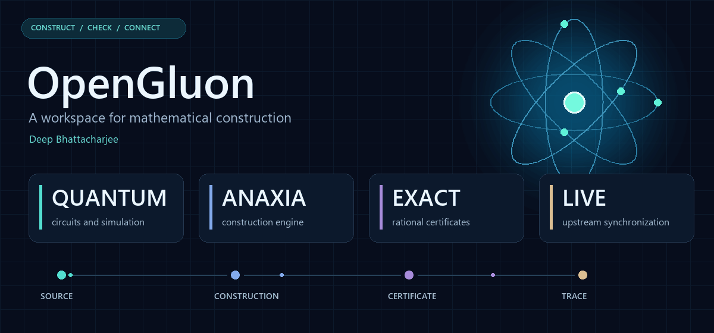
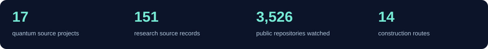
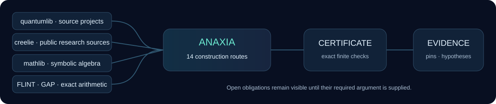

<picture>
  <source media="(prefers-reduced-motion: reduce)" srcset="docs/assets/opengluon.png">
  
</picture>

<p align="center">
  <a href="https://github.com/creelie/OpenGluon/actions/workflows/sync-quantumlib.yml"></a>
  <a href="docs/EXACT-CONSTRUCTIONS.md"></a>
  <a href="CONTRIBUTORS.md"></a>
</p>

# OpenGluon

Quantum software, mathematical constructions and inspectable evidence in one reproducible workspace. **Deep Bhattacharjee** maintains the project material. Every upstream library keeps its original authorship and license.

| Quantum laboratory | Construction engine | Mathematical toolkit | Research memory |
| :--- | :--- | :--- | :--- |
| **17** quantumlib projects | **Anaxia / eBLLM** | **4** libraries + Harmonic Lean examples | **150** public sources |
| Circuits · simulation · decoding | **14** targeted routes | Lean mathlib · SymPy | Pinned commits · release links |
| Chemistry · fermions · units | Exact rational LDLᵀ certificates | FLINT · GAP | Claims retain their proof scope |

<p align="center"></p>

<p align="center"></p>

```sh
git clone --recurse-submodules https://github.com/creelie/OpenGluon.git
cd OpenGluon
python opengluon.py doctor
python opengluon.py upstreams quantum
python opengluon.py portfolio seed
python opengluon.py routes Yang-Mills
python opengluon.py certify examples/rational-psd.json
```

**[Public upstream watch](docs/PUBLIC-UPSTREAM-WATCH.md)** · **[Research portfolio](docs/RESEARCH-PORTFOLIO.md)** · **[Construction routes](docs/CONSTRUCTION-ROUTES.md)** · **[Quantumlib inventory](docs/QUANTUMLIB.md)** · **[Automatic updates](docs/AUTOMATIC-UPDATES.md)** · **[Verification](docs/VERIFICATION.md)**

**[Harmonic tools](docs/HARMONIC.md)**: pinned IMO proof examples and the optional Aristotle client. The current client verifies supported programming languages through a hosted service; it does not accept pure mathematics or Lean-only projects as verification targets. Cloning it does not install the model or start an API run.

<details>
<summary><b>What is inside</b></summary>

| Directory | Contents |
| --- | --- |
| `quantumlib/` | Every public repository owned by quantumlib at capture, including archived/configuration repositories. Initial local clones have full Git history. |
| `engines/anaxia/` | The eBLLM engine as a pinned submodule, including the new portfolio, construction routes and exact finite matrix certificates. |
| `mathematics/mathlib4/` | Lean's mathematical library; use its pinned toolchain for formal work. |
| `mathematics/sympy/` | Symbolic algebra and exact expressions. |
| `mathematics/flint/` | Exact and rigorous arithmetic source library. |
| `mathematics/gap/` | Computational discrete algebra source library. |
| `mathematics/harmonic-imo2025/` | Harmonic's IMO 2025 Lean examples with their original toolchain and source files. Statement templates are distinguished from completed proof files. |
| `engines/aristotle/` | Unmodified optional client for Harmonic's hosted code-verification API. Its original license and API terms apply. |
| `scripts/` | Metadata-only upstream sync; upstream code is not executed by the sync job. |

Source checkouts are not preinstalled runtimes. Follow each project's own build and dependency instructions. The four external mathematical checkouts initially use shallow pinned source snapshots; quantumlib's 17 initial clones have full history.

</details>

<details>
<summary><b>How automatic updates work</b></summary>

Anaxia refreshes public inventories from Google, Google DeepMind, quantumlib and creelie hourly at minute 7 UTC. OpenGluon checks source default branches, including the two selected Harmonic repositories, and transfers Anaxia’s refreshed catalogues hourly at minute 17 UTC. Changed commits update the submodule pins and lock files. Newly discovered quantumlib repositories are included; disappeared ones retain their previous pin with a note. Use **Actions → Sync quantumlib → Run workflow** for a manual refresh. This polls upstreams; it is not an immediate Google webhook. GitHub can delay scheduled runs.

Update a local checkout after a remote sync:

```sh
git pull --ff-only
git submodule update --init --recursive
```

</details>

<details>
<summary><b>What a certificate means</b></summary>

The rational checker constructs and separately reconstructs A = L D Lᵀ, with D ≥ 0, over exact fractions. Its result proves positivity of the supplied finite matrix. Construction-route cards carry their remaining assumptions. Source records describe what the linked repository reports; this workspace does not turn them into independently audited proofs or claim a new Hodge, Lehmer, GSC or continuum Yang–Mills closure.

</details>

Upstream source and license details are in the submodules and [third-party notes](THIRD_PARTY.md). Commit pins are recorded in [`quantumlib-lock.json`](quantumlib-lock.json) and [`toolkit-lock.json`](toolkit-lock.json).
