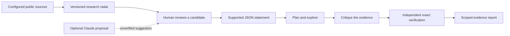

# Anaxia: research architecture and evidence

Anaxia is the new identity of the OpenGluon workspace. Its new local workbench joins public research discovery with exact, bounded mathematical experiments. Existing source libraries and eBLLM construction routes remain separately pinned.

## The research loop



1. **Discover.** Retrieve bounded public metadata from configured GitHub owners and searches, plus arXiv mathematics abstracts. Preserve source IDs, timestamps, and versions. Updates refresh the JSON snapshot, Markdown digest, and a marked section of the README.
2. **Formalize.** A researcher checks the source, determines whether a question is still open, and writes a supported JSON task. The current implementation does not translate arbitrary natural language conjectures into formal statements automatically.
3. **Plan.** Select an exact operation supported by the task: finite integer enumeration, quadratic sum-of-squares discovery, or supplied SOS certificate reconstruction.
4. **Explore.** Evaluate exact rational expressions within explicit input and computation budgets. Quadratic tasks can produce rational LDL-based SOS witnesses. Higher-degree SOS identities require a supplied certificate.
5. **Critique.** Separate global identities from evidence over a finite domain. Record unsuccessful search as inconclusive, and verify negative witnesses through exact substitution.
6. **Verify.** Independently reconstruct the certificate or rerun the finite claim from the submitted statement. Saved reports can be checked again through `python anaxia.py verify REPORT.json`.

These are deterministic software stages and audit records. They do not imply human cognition, consciousness, autonomous model agents, or general mathematical intelligence.

## Supported mathematical task

The laboratory accepts a JSON polynomial nonnegativity statement. Terms contain a rational coefficient and an exponent vector aligned with the named variables. Domains are either real variables or a finite integer box. Limits on variables, degree, coefficients, and search size keep experiments bounded.

For the exact supported schema, start with these runnable files:

| Example | What it exercises |
| --- | --- |
| [`quadratic-sos.json`](../examples/quadratic-sos.json) | Automatic exact quadratic SOS construction and independent verification. |
| [`quartic-sos.json`](../examples/quartic-sos.json) | A supplied higher-degree SOS identity checked by exact polynomial expansion. |
| [`bounded-polynomial.json`](../examples/bounded-polynomial.json) | Exhaustive evidence over a specified finite integer box. |
| [`false-polynomial.json`](../examples/false-polynomial.json) | An exact counterexample to a submitted nonnegativity claim. |

```sh
python anaxia.py solve examples/quadratic-sos.json --output data/demo-proof.json
python anaxia.py verify data/demo-proof.json
```

The initial laboratory supports 1–4 variables and polynomials of degree at most 12, with at most 256 terms. SOS discovery is quadratic; supplied SOS factors have degree at most 6. Integer searches are capped at 100,000 points and an additional arithmetic-work budget. Input limits can reject a task before computation.

## Automatic local experiments

The local task registry [`config/research-tasks.json`](../config/research-tasks.json) connects reviewed formal statements to repeatable computation. Run it directly:

```sh
python anaxia.py experiment --tasks config/research-tasks.json --output data/experiments
```

Each entry identifies a local task with `id` and `path`, marks whether it is a `tutorial`, and can retain a `source_url` or `reference`. The runner uses the supported laboratory methods, independently verifies the saved reports, and writes the [experiment digest](../data/experiments/README.md). The hourly research-radar workflow also runs this queue.

The initial four tasks are tutorials. Their results demonstrate the laboratory and do not constitute new solutions to arXiv conjectures. To add a research task, review the candidate and current literature, formalize its exact hypotheses in the supported format, then register the local task. Abstract detection alone never adds a purported solved conjecture to the queue.

## What the evidence establishes

| Status | Scope |
| --- | --- |
| `exact_sos_verified` | An exact identity `p = Σ wᵢ qᵢ²`, with rational `wᵢ ≥ 0`, establishes real nonnegativity of the submitted polynomial. |
| `bounded_verified` | The finite integer box is exhaustively checked. No extrapolation to all integers or reals follows. |
| `counterexample_verified` | An exact point in the stated domain has a negative polynomial value. |
| `inconclusive` | Search did not establish the submitted claim or find a checked counterexample. |

A solver's inability to find a certificate is not a disproof. A missing counterexample is not a proof over an infinite domain. Certificate reconstruction establishes an algebraic statement; an external conjecture additionally requires faithful formalization and review of every hypothesis.

The older matrix certificate command checks `A = L D Lᵀ` with nonnegative rational diagonal entries for a supplied finite matrix. It does not independently settle continuum limits or named open problems. See [exact constructions](EXACT-CONSTRUCTIONS.md).

## Research discovery and open-question candidates

The watch configuration controls owners, topic queries, arXiv categories, and fetch limits. Public GitHub discovery includes newly added repositories under configured owners within its page limits. Source discovery does not clone repositories automatically or execute their contents.

Abstract phrase detection identifies **reported open candidates** and keeps the matched excerpt. The label does not prove a statement is still open. It may refer to a historical question, a conjecture proved elsewhere, or a paper that closes the question itself. Candidate review must check the paper and subsequent literature.

Remote content is data. It is not an instruction to modify files, execute commands, spend money, or alter verification criteria. A refresh reports source failures and retains earlier successful records where available. A complete fetch failure leaves the previous published snapshot intact.

GitHub and arXiv impose coverage and rate limits. Searches return bounded subsets, feeds contain metadata and abstracts rather than full formal problem specifications, and scheduled workflows can run late. “Continuously refreshed” means scheduled polling of configured public sources.

## Optional model assistance

The Claude adapter sends an explicitly selected task to Anthropic's official Messages API only when the proposal command is invoked with configured credentials. The response is saved as unverified proposal text. It does not receive an execution tool, update mathematical statuses, or bypass the exact verifier.

Model output can help suggest a formalization or a strategy. The local laboratory's supported methods perform the checked computation. Further solver backends and formally checked theorem proofs are development directions, not capabilities implied by adding source repositories.

## Reproducibility

Keep the original task, evidence report, source links, and revision IDs together. Re-run `verify` after changing any claim, domain, polynomial, or certificate. Use the workflow logs to assess source freshness and the test suite to validate supported behavior.

The new workbench runs with Python 3.10+ and the standard library. Source libraries remain optional, have their own build requirements, and keep the commit pins recorded by the workspace.
