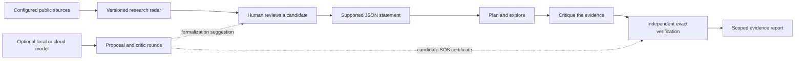

# Anaxia: research architecture and evidence

Anaxia extends the OpenGluon workspace into an open mathematics research engine. Public research feeds, local and cloud models, bounded reasoning loops, exact certificate checks, and reproducible conjecture experiments share explicit source and evidence records. Existing source libraries and eBLLM construction routes remain separately pinned.

## The research loop



1. **Discover.** Retrieve bounded public metadata from configured GitHub owners and searches, arXiv mathematics abstracts, community mathematics feeds, and selected blogs. Preserve source IDs, timestamps, and versions. Updates refresh the JSON snapshot, Markdown digest, and a marked section of the README.
2. **Formalize.** A researcher checks the source, determines whether a question is still open, and writes a supported JSON task. The current implementation does not translate arbitrary natural language conjectures into formal statements automatically.
3. **Plan.** Select an exact operation supported by the task: finite integer enumeration, quadratic sum-of-squares discovery, or supplied SOS certificate reconstruction.
4. **Explore.** Evaluate exact rational expressions within explicit input and computation budgets. Quadratic tasks can produce rational LDL-based SOS witnesses. Higher-degree SOS identities require a supplied certificate.
5. **Critique.** Separate global identities from evidence over a finite domain. Record unsuccessful search as inconclusive, and verify negative witnesses through exact substitution.
6. **Verify.** Independently reconstruct the certificate or rerun the finite claim from the submitted statement. Saved reports can be checked again through `python anaxia.py verify REPORT.json`.

The exact laboratory stages are deterministic software operations. The optional model loop adds proposals and critique around those operations, with a fixed round and request budget. Its audit records make the transition from a suggestion to checked evidence inspectable.

## Local and cloud reasoning loops

Model connections support Ollama, OpenAI-compatible servers such as llama.cpp, Anthropic, OpenAI, and Kimi. Profiles are recorded in [`config/model-profiles.json`](../config/model-profiles.json). Models must already be installed or available to the selected account; the connectors do not obtain model weights.

```sh
python anaxia.py models --provider ollama
python anaxia.py reason examples/quadratic-sos.json --provider ollama --model YOUR_MODEL_ID --rounds 2 --output data/reasoning-report.json
```

A proposer suggests a strategy or candidate SOS certificate, a critic reviews it, and the laboratory checks the candidate's exact polynomial identity. Each round records what happened. A successful certificate establishes the supported algebraic statement; unsuccessful or unsupported suggestions remain unverified. See the [model guide](MODELS.md) for provider choices, local endpoints, credentials, and limits.

## Supported mathematical task

The polynomial laboratory accepts a JSON nonnegativity statement. Terms contain a rational coefficient and an exponent vector aligned with the named variables. Domains are either real variables or a finite integer box. Limits on variables, degree, coefficients, and search size keep experiments bounded.

For the exact supported schema, start with these runnable files:

| Example | What it exercises |
| --- | --- |
| [`quadratic-sos.json`](../examples/quadratic-sos.json) | Automatic exact quadratic SOS construction and independent verification. |
| [`quartic-sos.json`](../examples/quartic-sos.json) | A supplied higher-degree SOS identity checked by exact polynomial expansion. |
| [`bounded-polynomial.json`](../examples/bounded-polynomial.json) | Exhaustive evidence over a specified finite integer box. |
| [`false-polynomial.json`](../examples/false-polynomial.json) | An exact counterexample to a submitted nonnegativity claim. |

```sh
python anaxia.py solve examples/quadratic-sos.json --output data/demo-proof.json
python anaxia.py verify data/demo-proof.json
```

The initial laboratory supports 1–4 variables and polynomials of degree at most 12, with at most 256 terms. SOS discovery is quadratic; supplied SOS factors have degree at most 6. Integer searches are capped at 100,000 points and an additional arithmetic-work budget. Input limits can reject a task before computation.

## Number theory and conjecture challenges

The modular-obstruction backend enumerates residue classes to prove that a supported submitted equation has no integer solution when a modulus excludes every class:

```sh
python anaxia.py diophantine examples/modular-obstruction.json --output data/modular-proof.json
```

The named challenge runner performs exact finite experiments for Collatz, Goldbach, Legendre, and Erdős–Straus. Target cards for problems such as Riemann, Hodge, and Yang–Mills identify unsupported goals and remaining work.

```sh
python anaxia.py challenge run --profile quick --output data/challenges
```

Finite challenge evidence retains its tested range. It does not establish the general conjecture. See [challenge definitions and current status](CHALLENGES.md); a research-paper claim requires a verified original result and complete proof.

## Automatic local experiments

The local task registry [`config/research-tasks.json`](../config/research-tasks.json) connects reviewed formal statements to repeatable computation. Run it directly:

```sh
python anaxia.py experiment --tasks config/research-tasks.json --output data/experiments
```

Each entry identifies a local task with `id` and `path`, marks whether it is a `tutorial`, and can retain a `source_url` or `reference`. The runner uses the supported laboratory methods, independently verifies the saved reports, and writes the [experiment digest](../data/experiments/README.md). The hourly research-radar workflow also runs this queue.

The initial four tasks are tutorials. Their results demonstrate the laboratory and do not constitute new solutions to arXiv conjectures. To add a research task, review the candidate and current literature, formalize its exact hypotheses in the supported format, then register the local task. Abstract detection alone never adds a purported solved conjecture to the queue.

## What the evidence establishes

| Status | Scope |
| --- | --- |
| `exact_sos_verified` | An exact identity `p = Σ wᵢ qᵢ²`, with rational `wᵢ ≥ 0`, establishes real nonnegativity of the submitted polynomial. |
| `bounded_verified` | The finite integer box is exhaustively checked. No extrapolation to all integers or reals follows. |
| `counterexample_verified` | An exact point in the stated domain has a negative polynomial value. |
| `inconclusive` | Search did not establish the submitted claim or find a checked counterexample. |

A solver's inability to find a certificate is not a disproof. A missing counterexample is not a proof over an infinite domain. Certificate reconstruction establishes an algebraic statement; an external conjecture additionally requires faithful formalization and review of every hypothesis.

The older matrix certificate command checks `A = L D Lᵀ` with nonnegative rational diagonal entries for a supplied finite matrix. It does not independently settle continuum limits or named open problems. See [exact constructions](EXACT-CONSTRUCTIONS.md).

## Research discovery and open-question candidates

The watch configuration controls owners, topic queries, arXiv categories, selected community and blog feeds, and fetch limits. Public GitHub discovery includes newly added repositories under configured owners within its page limits. Source discovery does not clone repositories automatically or execute their contents. MathOverflow, Mathematics Stack Exchange, and selected Tao/Gowers blog feeds broaden the research context; their questions and commentary remain source records rather than certified mathematical results.

Abstract phrase detection identifies **reported open candidates** and keeps the matched excerpt. The label does not prove a statement is still open. It may refer to a historical question, a conjecture proved elsewhere, or a paper that closes the question itself. Candidate review must check the paper and subsequent literature.

Remote content is data. It is not an instruction to modify files, execute commands, spend money, or alter verification criteria. A refresh reports source failures and retains earlier successful records where available. A complete fetch failure leaves the previous published snapshot intact.

GitHub and arXiv impose coverage and rate limits. Searches return bounded subsets, feeds contain metadata and abstracts rather than full formal problem specifications, and scheduled workflows can run late. “Continuously refreshed” means scheduled polling of configured public sources.

For wider metadata coverage, the opt-in arXiv archive harvests into a local database with resumable state. `archive harvest --max-pages 1 --set math` fetches a bounded mathematics batch; omitting `--set math` selects all subjects. Repeated runs resume the harvest. `archive status` reports progress, and `archive search "query" --limit 20` searches captured records. See the [source and archive guide](SOURCES.md) for storage, scope, and service limits.

## Model output and evidence

The `propose` command saves a single unverified response. The `reason` command records bounded proposal, critique, and exact-check rounds. Provider responses are treated as data and are not executed as code. The verifier controls supported certificate status. A model's confidence or wording cannot promote a result to a proof.

Local endpoints use the server and weights you configure. Cloud endpoints send the selected task and relevant loop context to the chosen provider using your credentials and may incur charges. Further solver backends and formally checked theorem proofs remain separate integration work, assessed through their actual behavior.

## Reproducibility

Keep the original task, evidence report, source links, and revision IDs together. Re-run `verify` after changing any claim, domain, polynomial, or certificate. Use the workflow logs to assess source freshness and the test suite to validate supported behavior.

The new workbench runs with Python 3.10+ and the standard library. Source libraries remain optional, have their own build requirements, and keep the commit pins recorded by the workspace.
