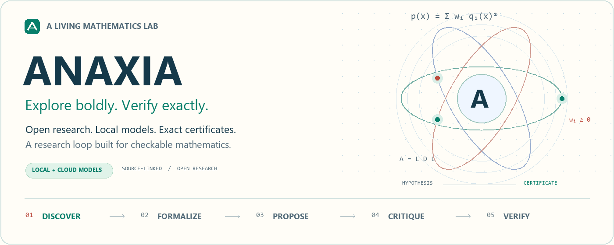

<p align="center"><a href="../../README.md">English</a> · <a href="README.hi.md">हिन्दी</a> · <b>বাংলা</b> · <a href="README.es.md">Español</a> · <a href="README.fr.md">Français</a> · <a href="README.zh-CN.md">简体中文</a></p>



# Anaxia — গাণিতিক অনুসন্ধান, যাচাইযোগ্য প্রমাণ

Anaxia একটি উন্মুক্ত গণিত গবেষণা কর্মক্ষেত্র। এতে নতুন গবেষণার সন্ধান, স্থানীয় ও ক্লাউড মডেল, পর্যায়ক্রমিক প্রস্তাব ও সমালোচনা, নির্ভুল গণনা এবং প্রমাণপত্রের স্বাধীন যাচাই একসঙ্গে রয়েছে। এটি OpenGluon প্রকল্পের নতুন রূপ।

## শুরু করুন

স্থানীয় মূল সরঞ্জামের জন্য Python 3.10+ ও Git যথেষ্ট। নিচের নির্ভুল গণনাগুলোর জন্য মডেল বা API কী প্রয়োজন নেই।

```sh
git clone https://github.com/creelie/Anaxia.git
cd Anaxia
python anaxia.py solve examples/quadratic-sos.json --output data/demo-proof.json
python anaxia.py verify data/demo-proof.json
python anaxia.py experiment --tasks config/research-tasks.json --output data/experiments
python anaxia.py challenge run --profile quick --output data/challenges
```

Ollama-তে নিজের মডেল ইনস্টল করে পরিষেবাটি চালু করার পরে:

```sh
python anaxia.py reason examples/quadratic-sos.json --provider ollama --model YOUR_MODEL_ID --rounds 2 --output data/reasoning-report.json
```

`YOUR_MODEL_ID`-এর জায়গায় ইনস্টল করা মডেলের নাম লিখুন। Ollama ও llama.cpp স্থানীয় বিকল্প; Claude, OpenAI ও Kimi ব্যবহার করতে নিজের অ্যাকাউন্টের API কী লাগবে। ক্লাউড অনুরোধে খরচ হতে পারে। [মডেল নির্দেশিকা](../MODELS.md) দেখুন।

## গবেষণার উৎস ও ফলাফল

গবেষণা রাডার GitHub, arXiv, MathOverflow, Mathematics Stack Exchange এবং নির্বাচিত গণিত ব্লগের প্রকাশ্য উৎস নির্ধারিত সীমার মধ্যে প্রতি ঘণ্টায় পরীক্ষা করে। [সাম্প্রতিক গবেষণা](../RESEARCH-RADAR.md) ও [উৎস নির্দেশিকা](../SOURCES.md) দেখুন। ঐচ্ছিক arXiv মেটাডেটা সংগ্রহ থামিয়ে পরে আবার চালানো যায়; সম্পূর্ণ arXiv ইতিমধ্যে সংগ্রহ করা হয়েছে, এমন দাবি নেই।

নির্ভুল SOS প্রমাণপত্র প্রদত্ত বহুপদটি সব বাস্তব মানের জন্য অঋণাত্মক, তা প্রতিষ্ঠা করতে পারে। সসীম পরীক্ষা শুধু নির্ধারিত পরিসরের জন্য প্রযোজ্য। কোনো অমীমাংসিত অনুমানের সাধারণ সমাধান দাবি করতে সঠিক গাণিতিক বিবৃতি, সম্পূর্ণ প্রমাণ ও স্বাধীন পর্যালোচনা প্রয়োজন। মডেলের প্রস্তাব নিজে থেকে প্রমাণ নয়।

[পরীক্ষার ফলাফল](../../data/experiments/README.md) · [অনুমান ও চ্যালেঞ্জের অবস্থা](../CHALLENGES.md) · [কাঠামো ও যাচাই](../ANAXIA.md) · [সম্পূর্ণ ইংরেজি README](../../README.md)

রক্ষণাবেক্ষণ: **Deep Bhattacharjee**। প্রকল্পের কোড MIT লাইসেন্সের অধীনে; বাইরের প্রকল্পগুলোর লেখকস্বত্ব ও লাইসেন্স অপরিবর্তিত। এটি বাংলায় প্রাথমিক নির্দেশিকা; বিস্তারিত নির্দেশ ইংরেজি নথিতে রয়েছে।
