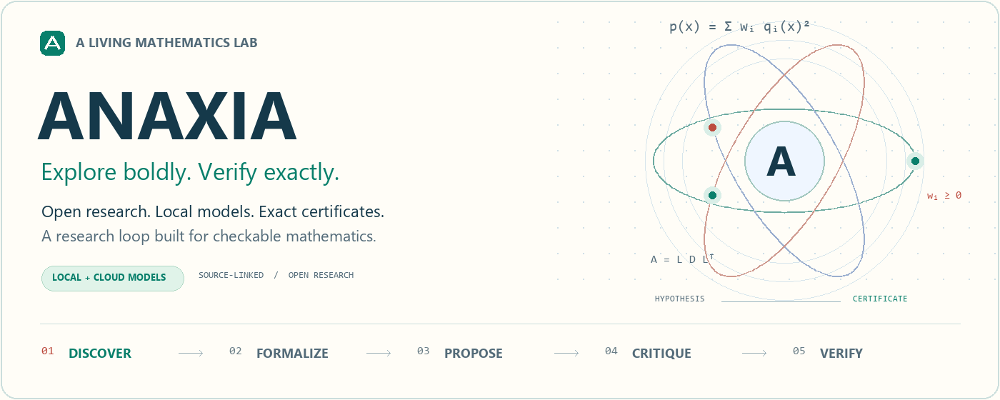

<p align="center"><a href="../../README.md">English</a> · <a href="README.hi.md">हिन्दी</a> · <a href="README.bn.md">বাংলা</a> · <b>Español</b> · <a href="README.fr.md">Français</a> · <a href="README.zh-CN.md">简体中文</a></p>



# Anaxia — Explora con ambición. Verifica con exactitud.

Anaxia es un entorno abierto de investigación matemática. Combina descubrimiento de publicaciones, modelos locales y en la nube, rondas de propuestas y crítica, cálculo exacto y verificación independiente de certificados. Es la evolución de OpenGluon.

## Primeros pasos

Python 3.10+ y Git bastan para el núcleo local. Estos experimentos exactos no requieren un modelo ni una clave de API.

```sh
git clone https://github.com/creelie/Anaxia.git
cd Anaxia
python anaxia.py solve examples/quadratic-sos.json --output data/demo-proof.json
python anaxia.py verify data/demo-proof.json
python anaxia.py experiment --tasks config/research-tasks.json --output data/experiments
python anaxia.py challenge run --profile quick --output data/challenges
```

Después de instalar un modelo e iniciar el servicio Ollama:

```sh
python anaxia.py reason examples/quadratic-sos.json --provider ollama --model YOUR_MODEL_ID --rounds 2 --output data/reasoning-report.json
```

Sustituye `YOUR_MODEL_ID` por el identificador del modelo instalado. Ollama y llama.cpp permiten inferencia local. Claude, OpenAI y Kimi requieren tus propias credenciales; sus solicitudes pueden generar cargos. Consulta la [guía de modelos](../MODELS.md).

## Fuentes y resultados

El radar consulta cada hora fuentes públicas configuradas de GitHub, arXiv, MathOverflow, Mathematics Stack Exchange y blogs matemáticos seleccionados, con límites explícitos. Consulta el [resumen de investigación](../RESEARCH-RADAR.md) y la [guía de fuentes](../SOURCES.md). El archivo opcional de metadatos de arXiv permite reanudar la descarga; no implica que todo arXiv ya esté indexado.

Un certificado SOS exacto puede demostrar la no negatividad real del polinomio presentado. Una comprobación finita solo cubre el dominio indicado. Resolver una conjetura abierta exige una formulación fiel, una demostración completa y revisión independiente. Las propuestas del modelo no son demostraciones por sí solas.

[Experimentos](../../data/experiments/README.md) · [Retos y estado](../CHALLENGES.md) · [Arquitectura y verificación](../ANAXIA.md) · [README completo en inglés](../../README.md)

Mantenido por **Deep Bhattacharjee**. El código del proyecto tiene licencia MIT; las dependencias conservan su autoría y sus licencias. Esta es una guía de inicio traducida; la documentación detallada está en inglés.
