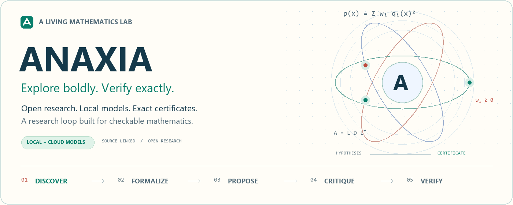

<p align="center"><a href="../../README.md">English</a> · <a href="README.hi.md">हिन्दी</a> · <a href="README.bn.md">বাংলা</a> · <a href="README.es.md">Español</a> · <b>Français</b> · <a href="README.zh-CN.md">简体中文</a></p>



# Anaxia — Explorer avec ambition. Vérifier avec exactitude.

Anaxia est un environnement ouvert de recherche mathématique. Il associe veille scientifique, modèles locaux et distants, cycles de proposition et de critique, calcul exact et vérification indépendante de certificats. Il prolonge le projet OpenGluon.

## Démarrage

Python 3.10+ et Git suffisent pour le noyau local. Ces expériences exactes ne nécessitent ni modèle ni clé d'API.

```sh
git clone https://github.com/creelie/Anaxia.git
cd Anaxia
python anaxia.py solve examples/quadratic-sos.json --output data/demo-proof.json
python anaxia.py verify data/demo-proof.json
python anaxia.py experiment --tasks config/research-tasks.json --output data/experiments
python anaxia.py challenge run --profile quick --output data/challenges
```

Après avoir installé un modèle et démarré le service Ollama :

```sh
python anaxia.py reason examples/quadratic-sos.json --provider ollama --model YOUR_MODEL_ID --rounds 2 --output data/reasoning-report.json
```

Remplacez `YOUR_MODEL_ID` par l'identifiant du modèle installé. Ollama et llama.cpp permettent l'inférence locale. Claude, OpenAI et Kimi nécessitent vos propres identifiants ; les appels peuvent être facturés. Consultez le [guide des modèles](../MODELS.md).

## Sources et résultats

Le radar interroge chaque heure des sources publiques configurées sur GitHub, arXiv, MathOverflow, Mathematics Stack Exchange et des blogs mathématiques sélectionnés, dans des limites explicites. Consultez la [veille scientifique](../RESEARCH-RADAR.md) et le [guide des sources](../SOURCES.md). L'archive facultative de métadonnées arXiv permet une collecte reprenable ; elle ne signifie pas que tout arXiv est déjà indexé.

Un certificat SOS exact peut démontrer la positivité au sens large du polynôme soumis sur les réels. Une vérification finie ne couvre que le domaine indiqué. Résoudre une conjecture ouverte exige une formulation fidèle, une démonstration complète et une expertise indépendante. Une proposition du modèle ne constitue pas, à elle seule, une preuve.

[Expériences](../../data/experiments/README.md) · [Défis et état des résultats](../CHALLENGES.md) · [Architecture et vérification](../ANAXIA.md) · [README complet en anglais](../../README.md)

Maintenu par **Deep Bhattacharjee**. Le code du projet est sous licence MIT ; les projets tiers conservent leurs auteurs et leurs licences. Cette page est un guide de démarrage traduit ; la documentation détaillée est en anglais.
