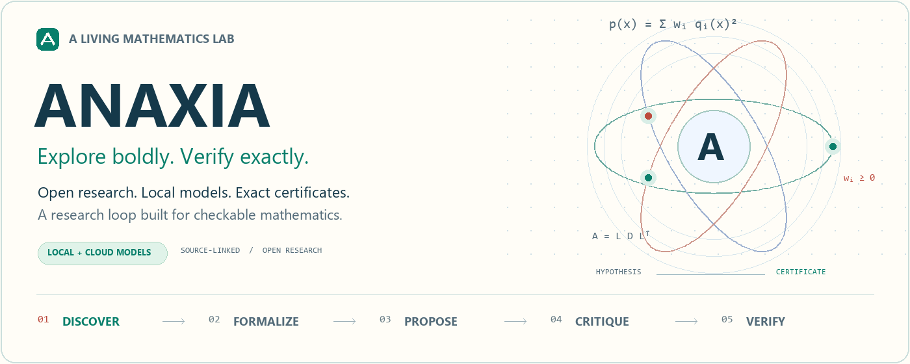

<p align="center"><a href="../../README.md">English</a> · <b>हिन्दी</b> · <a href="README.bn.md">বাংলা</a> · <a href="README.es.md">Español</a> · <a href="README.fr.md">Français</a> · <a href="README.zh-CN.md">简体中文</a></p>



# Anaxia — गणितीय खोज, जाँचे जा सकने वाले प्रमाण

Anaxia एक खुला गणितीय शोध कार्यक्षेत्र है। इसमें नई शोध सामग्री की खोज, स्थानीय और क्लाउड मॉडल, प्रस्ताव और आलोचना के क्रमिक चरण, सटीक गणना तथा प्रमाणपत्रों का स्वतंत्र सत्यापन शामिल हैं। यह OpenGluon परियोजना का नया रूप है।

## शुरुआत

स्थानीय मुख्य उपकरणों के लिए Python 3.10+ और Git पर्याप्त हैं। इन सटीक गणनाओं के लिए मॉडल या API कुंजी की आवश्यकता नहीं है।

```sh
git clone https://github.com/creelie/Anaxia.git
cd Anaxia
python anaxia.py solve examples/quadratic-sos.json --output data/demo-proof.json
python anaxia.py verify data/demo-proof.json
python anaxia.py experiment --tasks config/research-tasks.json --output data/experiments
python anaxia.py challenge run --profile quick --output data/challenges
```

Ollama में अपना मॉडल स्थापित करके सेवा शुरू करने के बाद:

```sh
python anaxia.py reason examples/quadratic-sos.json --provider ollama --model YOUR_MODEL_ID --rounds 2 --output data/reasoning-report.json
```

`YOUR_MODEL_ID` को अपने स्थापित मॉडल के नाम से बदलें। Ollama और llama.cpp स्थानीय विकल्प हैं; Claude, OpenAI और Kimi के लिए अपने खाते की API कुंजी चाहिए। क्लाउड अनुरोधों का शुल्क लग सकता है। [मॉडल मार्गदर्शिका](../MODELS.md) देखें।

## शोध सामग्री और परिणाम

शोध रडार GitHub, arXiv, MathOverflow, Mathematics Stack Exchange और चुने हुए गणितीय ब्लॉगों के सार्वजनिक स्रोतों को निर्धारित सीमाओं में हर घंटे जाँचता है। [ताज़ा शोध सूची](../RESEARCH-RADAR.md) और [स्रोत मार्गदर्शिका](../SOURCES.md) देखें। वैकल्पिक arXiv मेटाडेटा संग्रह को रोककर फिर से शुरू किया जा सकता है; पूरा arXiv पहले से संग्रहित होने का दावा नहीं है।

सटीक SOS प्रमाणपत्र दिए गए बहुपद की वास्तविक संख्याओं पर अऋणात्मकता सिद्ध कर सकता है। सीमित परीक्षण केवल बताए गए परास तक मान्य है। किसी खुले अनुमान का सामान्य समाधान स्थापित करने के लिए सही गणितीय कथन, पूर्ण प्रमाण और स्वतंत्र समीक्षा आवश्यक हैं। मॉडल का सुझाव अपने-आप प्रमाण नहीं बनता।

[प्रयोग परिणाम](../../data/experiments/README.md) · [चुनौतियाँ और उनकी स्थिति](../CHALLENGES.md) · [संरचना और सत्यापन](../ANAXIA.md) · [पूरा अंग्रेज़ी README](../../README.md)

रखरखाव: **Deep Bhattacharjee**। परियोजना का कोड MIT लाइसेंस के अंतर्गत है; बाहरी परियोजनाओं के लेखक और लाइसेंस यथावत हैं। यह हिन्दी प्रवेश मार्गदर्शिका है; विस्तृत निर्देश अंग्रेज़ी दस्तावेज़ों में हैं।
