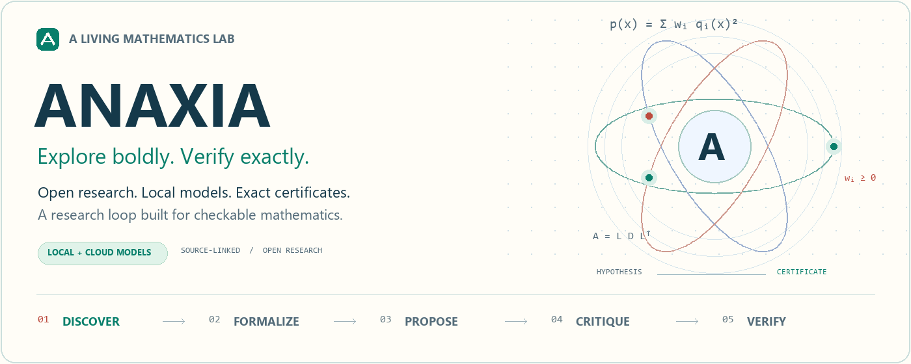

<p align="center"><a href="../../README.md">English</a> · <a href="README.hi.md">हिन्दी</a> · <a href="README.bn.md">বাংলা</a> · <a href="README.es.md">Español</a> · <a href="README.fr.md">Français</a> · <b>简体中文</b></p>



# Anaxia — 大胆探索，精确验证

Anaxia 是一个开放的数学研究工作台，整合研究动态发现、本地与云端模型、提案与批评循环、精确计算，以及证明证书的独立验证。它在原 OpenGluon 项目的基础上发展而来。

## 快速开始

本地核心只需 Python 3.10+ 和 Git。以下精确计算不需要模型或 API 密钥。

```sh
git clone https://github.com/creelie/Anaxia.git
cd Anaxia
python anaxia.py solve examples/quadratic-sos.json --output data/demo-proof.json
python anaxia.py verify data/demo-proof.json
python anaxia.py experiment --tasks config/research-tasks.json --output data/experiments
python anaxia.py challenge run --profile quick --output data/challenges
```

在 Ollama 中安装模型并启动服务后，可运行：

```sh
python anaxia.py reason examples/quadratic-sos.json --provider ollama --model YOUR_MODEL_ID --rounds 2 --output data/reasoning-report.json
```

请将 `YOUR_MODEL_ID` 替换为已安装模型的标识符。Ollama 和 llama.cpp 支持本地推理；Claude、OpenAI 和 Kimi 需要您自己的账户凭据，调用可能产生费用。详见[模型指南](../MODELS.md)。

## 研究来源与结果

研究雷达每小时在配置的范围和数量限制内检查 GitHub、arXiv、MathOverflow、Mathematics Stack Exchange 及选定数学博客的公开内容。参见[研究摘要](../RESEARCH-RADAR.md)与[来源指南](../SOURCES.md)。可选的 arXiv 元数据归档支持断点续传；这不表示整个 arXiv 已经完成索引。

精确 SOS 证书可以证明提交的多项式在实数域上非负。有限范围验证只适用于指定范围。解决开放猜想还需要忠实的数学表述、完整证明及独立审查。模型生成的建议本身不构成证明。

[实验结果](../../data/experiments/README.md) · [猜想挑战与状态](../CHALLENGES.md) · [架构与验证](../ANAXIA.md) · [完整英文 README](../../README.md)

维护者：**Deep Bhattacharjee**。项目代码采用 MIT 许可证；第三方项目保留各自作者署名和许可证。本页为中文入门指南，详细文档以英文版为准。
